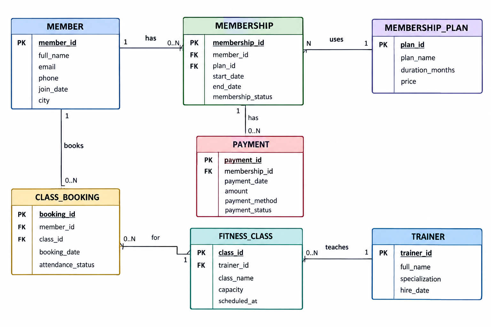

# Gym Membership and Management System

This project is a relational database for managing a gym, written in Oracle SQL. It covers members, membership plans, memberships, trainers, fitness classes, class bookings, and payments.

---

## Table of Contents

- [Overview](#overview)
- [Entity-Relationship Diagram](#entity-relationship-diagram)
- [Database Schema](#database-schema)
- [Features](#features)
- [Project Structure](#project-structure)
- [Getting Started](#getting-started)
- [Query Showcase](#query-showcase)
- [Technologies Used](#technologies-used)
- [Author](#author)

---

## Overview

The database is made up of seven tables:

| # | Table | Purpose |
|---|-------|---------|
| 1 | `MEMBER` | Member information and contact details |
| 2 | `MEMBERSHIP_PLAN` | Plan definitions, durations, and pricing |
| 3 | `MEMBERSHIP` | Member subscriptions and their statuses |
| 4 | `TRAINER` | Trainer information and specializations |
| 5 | `FITNESS_CLASS` | Class details, schedules, capacities, and assigned trainers |
| 6 | `CLASS_BOOKING` | Bookings between members and fitness classes (M:N junction) |
| 7 | `PAYMENT` | Membership payments, methods, amounts, and statuses |

---

## Entity-Relationship Diagram

The diagram below shows the entities, attributes, primary keys, foreign keys, and relationships.
The many-to-many relationship between `MEMBER` and `FITNESS_CLASS` is handled by the `CLASS_BOOKING` junction table.



> Submission document (ERD, SQL statements, queries, and query outputs): [`docs/GYM_DB.pdf`](docs/GYM_DB.pdf)

---

## Database Schema

### `MEMBER`
| Column | Type | Constraints |
|--------|------|-------------|
| `member_id` | NUMBER | PK, Identity |
| `full_name` | VARCHAR2(100) | NOT NULL |
| `email` | VARCHAR2(100) | Nullable, UNIQUE |
| `phone` | VARCHAR2(20) | — |
| `join_date` | DATE | NOT NULL, DEFAULT `SYSDATE` |
| `city` | VARCHAR2(50) | — |

### `MEMBERSHIP_PLAN`
| Column | Type | Constraints |
|--------|------|-------------|
| `plan_id` | NUMBER | PK, Identity |
| `plan_name` | VARCHAR2(100) | NOT NULL |
| `duration_months` | NUMBER | NOT NULL, `CHECK (> 0)` |
| `price` | NUMBER(10,2) | NOT NULL, `CHECK (>= 0)` |

### `MEMBERSHIP`
| Column | Type | Constraints |
|--------|------|-------------|
| `membership_id` | NUMBER | PK, Identity |
| `member_id` | NUMBER | NOT NULL, FK → `MEMBER` |
| `plan_id` | NUMBER | NOT NULL, FK → `MEMBERSHIP_PLAN` |
| `start_date` | DATE | NOT NULL |
| `end_date` | DATE | Nullable, `CHECK (end_date IS NULL OR end_date >= start_date)` |
| `membership_status` | VARCHAR2(20) | NOT NULL, `CHECK IN ('Active','Expired','Pending')` |

### `TRAINER`
| Column | Type | Constraints |
|--------|------|-------------|
| `trainer_id` | NUMBER | PK, Identity |
| `full_name` | VARCHAR2(100) | NOT NULL |
| `specialization` | VARCHAR2(100) | — |
| `hire_date` | DATE | NOT NULL |

### `FITNESS_CLASS`
| Column | Type | Constraints |
|--------|------|-------------|
| `class_id` | NUMBER | PK, Identity |
| `class_name` | VARCHAR2(100) | NOT NULL |
| `trainer_id` | NUMBER | FK → `TRAINER` (nullable) |
| `capacity` | NUMBER | NOT NULL, `CHECK (> 0)` |
| `scheduled_at` | TIMESTAMP | NOT NULL |

### `CLASS_BOOKING`
| Column | Type | Constraints |
|--------|------|-------------|
| `booking_id` | NUMBER | PK, Identity |
| `member_id` | NUMBER | NOT NULL, FK → `MEMBER` |
| `class_id` | NUMBER | NOT NULL, FK → `FITNESS_CLASS` |
| `booking_date` | DATE | NOT NULL, DEFAULT `SYSDATE` |
| `attendance_status` | VARCHAR2(20) | NOT NULL, `CHECK IN ('Booked','Attended','Absent','Cancelled')` |

### `PAYMENT`
| Column | Type | Constraints |
|--------|------|-------------|
| `payment_id` | NUMBER | PK, Identity |
| `membership_id` | NUMBER | NOT NULL, FK → `MEMBERSHIP` |
| `payment_date` | DATE | NOT NULL, DEFAULT `SYSDATE` |
| `amount` | NUMBER(10,2) | NOT NULL, `CHECK (>= 0)` |
| `payment_method` | VARCHAR2(30) | NOT NULL, `CHECK IN ('Cash','Card','Bank Transfer')` |
| `payment_status` | VARCHAR2(20) | NOT NULL, `CHECK IN ('Successful','Pending','Failed')` |

---

## Features

- Primary key and foreign key constraints on all relationships
- Identity columns that generate the primary key values automatically
- `NOT NULL`, `UNIQUE`, and `CHECK` constraints
- `DEFAULT SYSDATE` on `join_date`, `booking_date`, and `payment_date`
- One-to-many relationships, and a many-to-many relationship between members and classes resolved by `CLASS_BOOKING`
- Sample data (4 rows per table), including rows that produce NULLs in the outer-join queries
- 15 queries using:
  - inner, left, and right joins
  - aggregate functions (`COUNT`, `SUM`, `AVG`, `MIN`, `MAX`)
  - `GROUP BY`, `HAVING`, `ORDER BY`
  - `CASE` expressions
  - `NVL` and `COALESCE`

---

## Project Structure

```
Gym-Membership-ERD/
├── README.md              # Project documentation (this file)
├── sql/
│   └── GYM_SQL.sql        # Oracle SQL script: schema, sample data, queries
├── docs/
│   ├── GYM_DB.pdf         # Main submission: ERD, SQL, queries + outputs
│   └── GYM_SQL.pdf        # PDF version of the SQL code
└── erd/
    └── GYM_ERD.png        # Entity-Relationship Diagram
```

---

## Getting Started

### Prerequisites

- Oracle Database **12c or later** (identity columns require 12c+)
- A client such as **SQL*Plus**, **SQL Developer**, or **Oracle LiveSQL**

### Run the Script

Using SQL Developer: open `sql/GYM_SQL.sql` and click **Run Script** (F5).

> **Note:** The script drops existing tables using `DROP TABLE ... CASCADE CONSTRAINTS` before recreating them. This deletes those tables and their data. Run the script only in a development schema where this is acceptable. If a table does not exist, its DROP statement may report an error; check how your SQL client handles script errors.

### Script Sections

| Section | Contents |
|---------|----------|
| 1 | Drop existing tables |
| 2 | Create tables with constraints |
| 3 | Insert sample data + `COMMIT` |
| 4 | 15 queries |

---

## Query Showcase

| # | Query | Techniques |
|---|-------|-----------|
| 1 | Membership details with member and plan names | `INNER JOIN` |
| 2 | All members, including those without memberships | `LEFT JOIN`, `NVL` |
| 3 | All fitness classes, including those without bookings | `RIGHT JOIN`, `NVL` |
| 4 | All trainers, including those without classes | `LEFT JOIN`, `NVL` |
| 5 | Membership counts and average plan prices for plans that have memberships | `INNER JOIN`, `COUNT`, `AVG`, `ORDER BY` |
| 6 | Total class bookings per member | `LEFT JOIN`, `COUNT`, `ORDER BY` |
| 7 | Total revenue by membership plan from successful payments | `INNER JOIN`, `SUM`, `WHERE` |
| 8 | Booking count per fitness class | `LEFT JOIN`, `COUNT`, `ORDER BY` |
| 9 | Classify membership status labels | `CASE` |
| 10 | Best available contact method per member | `COALESCE` |
| 11 | Total payment amount per membership, including memberships with no payments | `LEFT JOIN`, `NVL(SUM(...), 0)` |
| 12 | Class count per trainer | `LEFT JOIN`, `COUNT`, `ORDER BY` |
| 13 | Payment details with human-readable status | `CASE`, `ORDER BY DESC` |
| 14 | Payment statistics by method | `SUM`, `AVG`, `MIN`, `MAX`, `COUNT`, `GROUP BY` |
| 15 | Members with ≥ 2 successful payments, their successful payment counts, and total amounts | `INNER JOIN`, `HAVING`, `ORDER BY` |

---

## Technologies Used

- **Oracle SQL**: DDL, DML, and queries
- **Relational database design**: keys and referential integrity
- **ER diagram**: logical model of the tables

---

## Author

**Diana Naif Khalil**
